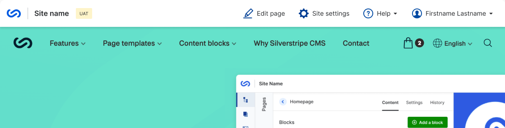

# Betamask Admin Overlay

Adds an admin tool bar, styled with [betamask](https://github.com/silverstripeltd/betamask), to the
front end of a Silverstripe CMS site. Each CMS user turns it on for themselves.



## Requirements

* PHP ^8.3
* Silverstripe CMS 6.1+ (`silverstripe/admin` ^3.1, `silverstripe/siteconfig` ^6.1)
* [`silverstripeltd/featureflag`](https://github.com/silverstripeltd/featureflag)

## Installation

Both packages are private, so add their repositories to your project's `composer.json`. Composer does
not read `repositories` from a dependency:

```json
"repositories": [
    { "type": "vcs", "url": "git@github.com:silverstripeltd/betamask-feab.git" },
    { "type": "vcs", "url": "git@github.com:silverstripeltd/featureflag.git" }
]
```

```sh
composer require silverstripeltd/betamask-bao
```

## Turning the bar on

1. Go to `/admin/myprofile`
1. Tick **Admin tool bar** in the features section and save

The bar only appears for users who have ticked it.

## How it works

When a user with the bar enabled navigates to a front-end page, the response is a small wrapper
document: the tool bar at the top and the real page loaded below it in an iframe. The page is
rendered only once, by the iframe request, so its status code, headers, form messages and other
side effects behave exactly as they do without the bar.

The wrapper is only served for top-level HTML page navigations made with `GET`. These requests are
always passed through untouched:

* `fetch()`/XHR calls, sub-resources, and anything that does not accept HTML
* URLs with a file extension (`sitemap.xml`, `robots.txt`, downloads) and `assets/`
* the CMS (`admin/`), `dev/`, and the Security login, logout and password pages
* the CMS preview panel (`CMSPreview=1`)

Inside the iframe, a small script keeps the bar in step with the page. It updates the browser
address bar and title, points **Edit page** at the current page, and closes open menus when the
page is clicked. It marks internal links and form submissions with `InlinePreview=1`, which keeps
them in the frame on browsers that send no Fetch Metadata headers, such as on plain-HTTP
development sites. External links open in the top window.

The framed page is shown in the draft (`Stage`) reading mode unless the URL asks for another stage.

The iframe keeps the bar completely separate from the site: the site's CSS, layout and scripts
cannot affect the bar, and the bar cannot affect the site. Because the site runs inside a frame:

* The site must allow same-origin framing. `X-Frame-Options: SAMEORIGIN` or
  `frame-ancestors 'self'` are fine; `DENY` or `'none'` leave the frame blank.
* Scripts that break out of frames (`if (top !== self) top.location = ...`) take the page out of the bar.
* Third-party flows that refuse to be framed, such as some payment or sign-in providers, need their
  form or link to target `_top`. Links to other sites already open in the top window.

## Configuration

```yaml
SilverStripe\Betamask\Frontend\TopBar\TopBarUI:
  # Never show the bar under these URL prefixes (relative to the site root)
  disable_on_url:
    - 'shop/checkout/'
  # Reading stage for the framed page; '' keeps the request's own stage
  default_stage: 'Stage'
  # Favicon of the wrapper document; '' to omit it
  favicon: 'themes/app/dist/images/favicon/favicon-32x32.png'
  # Label shown for each environment type; others show "uat" or "test"
  environments:
    dev: 'dev'
    live: 'prod'
```

## Extending the bar

### Menu items

Apply an extension to `TopBarMenu` and implement `updateItems()`. Items are keyed by id. The built-in
ids are available as constants: `ITEM_EDIT`, `ITEM_SETTINGS`, `ITEM_HELP` and `ITEM_PROFILE`.

```php
use SilverStripe\Betamask\Frontend\TopBar\TopBarMenu;
use SilverStripe\Core\Extension;

class TopBarMenuExtension extends Extension
{
    protected function updateItems(array &$items): void
    {
        // A dropdown
        $items['reports'] = [
            'label' => 'Reports',
            'icon' => 'font-icon-chart-line',
            'items' => [
                ['label' => 'Broken links', 'link' => '/admin/reports/broken-links'],
                ['label' => 'Analytics', 'link' => 'https://analytics.example.com', 'target' => '_blank'],
            ],
        ];

        // A link added to an existing dropdown
        $items[TopBarMenu::ITEM_HELP]['items'][] = ['label' => 'Style guide', 'link' => '/style-guide'];

        // Remove an item
        unset($items[TopBarMenu::ITEM_SETTINGS]);
    }
}
```

```yaml
SilverStripe\Betamask\Frontend\TopBar\TopBarMenu:
  extensions:
    - App\Extension\TopBarMenuExtension
```

The array order is the display order. Each item supports:

| Key | Description |
|---|---|
| `label` | Required. Visible text. |
| `link` | Makes the item a plain link instead of a dropdown. |
| `target` | Link target, e.g. `_blank`. |
| `icon` | Admin font icon class, e.g. `font-icon-chart-line`. |
| `items` | Dropdown entries, each with `label`, `link` and optional `target`. |
| `heading` | HTML shown at the top of the dropdown. It is rendered as-is, so only pass trusted markup. |
| `css_modifier` | Modifier for the item's `topbar__action--*` class. |

Items without a label, and dropdown entries without a label or link, are dropped.

### Turning the bar off for more requests

Apply an extension to `TopBarUI` and implement `updateIsEnabled(bool &$enabled)`. `getOwner()->getRequest()`
gives you the request being considered.

### Edit page link

The **Edit page** link uses the CMS edit link of the record returned by the page controller's
`data()`. Any controller can provide its own link instead by implementing `getPageEditUrl(): string`.

## Development

```sh
nvm use          # Node 20
yarn install
yarn build       # writes client/dist, which is committed
yarn lint
```

Run the PHP tests from a project that has the module installed:

```sh
vendor/bin/phpunit vendor/silverstripeltd/betamask-bao/tests
```
